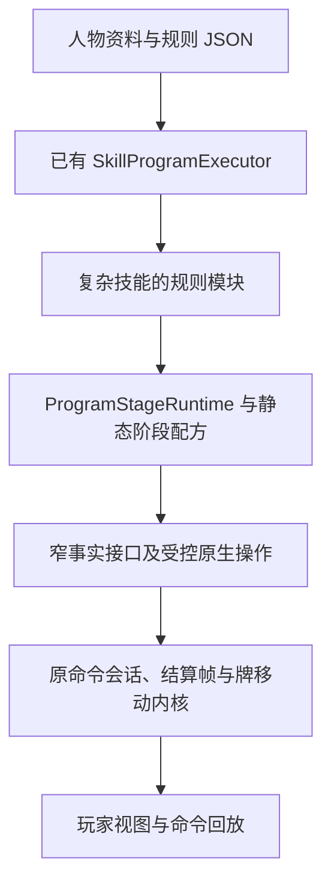

# 原生技能的公共阶段协议

日期：2026-10-31。源码基线：`19007ea37`。本批在独立分支中接入公共阶段协议和有代表性的原生机制，不包含另一路对命令会话、运行时注册和调度器的大范围重构。

## 现有架构与本批边界

纯配置人物可以只增加人物资料和技能 JSON。复杂人物仍有自己的阶段、付款回执及 `GameEngine` 适配器；目录隔离没有改变它们编译进 Core 的事实。操作和模块注册已经自动发现，普通步骤也已经由 `SkillProgramExecutor` 执行，不需要第二套 JSON 解释器。

本批增加 `ProgramStageRuntime`，作为已有执行器中原生复合操作的子步骤协调器。它统一原帧准入、等待子结算、返回后重读账单、声明式阶段转移及先保存阶段再执行动作。人物仍提供规则资格、合法选择、真正的移动/健康操作和动态来源证明。

计划保存不可变节点和开放委托，不保存对局、当前帧、候选牌或待决选择。运行模块实例继续只持有窄接口。暂停状态全部在原 `ProgramSkillFrame` 的强类型 receipt 上；不新增全局 pending、use-ID sidecar 或 `Dictionary<string, object>`。

## 配方与控制契约

| 节点 | 协议 |
| --- | --- |
| `Run` | 执行实际规则回调，返回继续或让出；继续必须推进原帧 |
| `Prompt` | 发布原有选择后让出；选择的权限、revision、PromptId 与原选项验证保留 |
| `AwaitExternalReturn` | 等待原生摸牌等已有类型化返回；不能仅因原帧在栈顶便继续 |
| `AwaitChildren` | 按原机制排空子窗口，重新读取同一原帧及当前 receipt，再运行返回动作 |
| `ChildrenTo` / `ChildrenComplete` | 声明等待后转阶段或完成，避免每个人物复制清理与返回包装 |
| `RunTo` | 声明下一阶段并执行原动作；默认先提交阶段，原有同步后提交流程显式使用 `commitBefore:false` |

加载静态配方时检查阶段唯一、跳转目标已注册以及必要的状态写入、排空和完成端口。声明式写入必须保持帧 ID、拥有者、技能实例、绑定、玩法 hash 和指令游标，并实际写入目标阶段；校验通过后才允许真实动作。

`drain=false`、完成事实回调和后提交动作是同步边界：允许更新同阶段的实际数量或账单，不能偷偷打开新提示、压入子帧或切换暂停阶段。违反契约会抛出异常，由原命令会话故障/恢复路径处理，避免恢复时重复发事实或重复支付。真正能挂起的动作应先提交等待阶段，并经已有类型化返回继续。

窗口顺序、清移动续接的时点、结束条件与死亡/失技继续权限都是明确的配方策略。公共运行器没有统一放行权限，也没有在每个节点前强加同一死亡或终局判断。

## 三个原生机制接入

| 机制 | 阶段 | 必须保持的差异 |
| --- | ---: | --- |
| 谋曹洪 | 8 | 获得与返还都按真实移动数量；完成段事实先于清 pending；已支付子段原帧续接 |
| 曹宪 | 11 | 等待原生摸牌或已支付子阶段后再检查终止；精确翼堆来源与真实移出付款不变 |
| 谋曹爽 | 14 | 移牌/摸牌后清 pending，回复等子阶段保留原策略；授技先同步执行，再在返回的原帧写下一阶段 |

三个角色不再各写一个 `Continue` 推进循环；13 个等待子结算阶段共用排空及返回协议，其中 11 个直接声明转阶段或完成。三个付款入口使用 `Issue` 保存原帧后才执行动作。保留全部原选择、付款、native draw 返回与来源检查。

## OL 与欢乐归心合用一个状态机

原两套阶段、receipt、付款 record 和证明主体合为 `ProgramSeatAcquisitionStage/Receipt/Payment`，只在原帧保存一个 `SeatAcquisition`。公共模块统一冻结逐席顺序、跳过、RNG 选择、真实移动签发、付款记录、子窗口排空、游标推进及完成。

版本策略只提供实际差异和原标量事件投影：

- OL 保留一次优先区域选择及规定的区域回退，在首个非空区域内随机取牌，扫取结束翻面。
- 欢乐在所有合法区域候选中随机，只有累计真实进入自己手牌的移动超过四张、且原状态正面朝上时翻面；不是按最终手牌数判断。
- 两版保留原事件类型、移动原因、伤害点及技能实例身份、冻结候选、RNG 重建、精确移动目的地与 `Sequence == After`。旧操作作为兼容内容入口保留。

移动归心继续使用其原协议：逐席人为选择与左慈幻影获得后同步销毁尾部没有合并进共同付款证明。神赋、清俭各版触发及费用不同，也没有仅按技能名合并。

新状态的座位、付款及嵌套候选/移动列表均复制并冻结，未进入玩家视图。Checkpoint 仍记录初始化与接受命令；诊断帧的内部类型调整不改变 checkpoint、回放或命令格式。规则 schema、内容包版本和规则 epoch 均未改。

## 实际收益与成本

按 UTF-8、统一 LF、忽略 BOM，对源码基线逐文件比较：

| 范围 | C# 文本净变化 |
| --- | ---: |
| OL 与欢乐归心六个人物 Runtime 文件 | -22,469 字节 |
| 三个代表人物 Runtime 文件 | +5,498 字节 |
| 人物侧合计 | **-16,971 字节** |
| 两个新公共组件 | +40,706 字节 |
| 生产代码合计 | **+23,735 字节** |
| 测试代码 | +47,357 字节 |
| 含测试的 C# 合计 | +71,092 字节 |

这是把重复控制与证明合为公共实现的一次基础投入，不能称为全库代码净缩减，更不能外推为删除三分之一人物代码。三个代表的静态配方增加了声明文本，但以后修改公共推进契约不再逐个修改其循环。归心则实际删除了一套状态机和证明主体。

`ProgramSkillFrame` 自身公开实例属性由 828 变为 827；两个人物专属字段合为一个机制字段。操作枚举保持 1861，数量枚举保持 31；未改 JSON 内容及操作归属，前批的两个 JSON 技能代理指标没有提升。它们不能当作严格的纯 JSON 武将比例。本批没有新增武将，不计算“每新增武将 C# 平均量”。

## 后续扩展边界

已有 JSON 能表达的技能继续用 JSON。原生多阶段技能优先复用阶段节点和已存在的机制状态；真正的新规则再增加窄事实/操作端口。原始支付、材料、随机和父帧身份必须由其机制证明。

本批尚未拆分人物程序集，也没有替换中心操作枚举或迁走所有人物字段。这些需要与后续注册和运行时重构分别集成，不能把本分支验证解释为另一批重构已通过。

## 验证范围

独立工作树以 `19007ea37` 为基线，只叠加本批文件。最终 Core 定向共 22 项通过，覆盖三个代表机制、两版归心与移动版幻影尾部、阶段配方及挂起边界、运行模块隔离、原生/窗口返回、技能变更、原帧隐私、提交集合冻结和 checkpoint 玩法指纹。新迎驾检查在获得和返还两个真实子结算处分别冷恢复；新欢乐归心检查覆盖六人与四人场景、实际获得后弃掉所得牌、翻面门槛、背面不再翻以及随机付款冷恢复。

定向构建 6.54 秒、依赖验证 0.22 秒、检查进程 16.84 秒。例行范围为 4 项 smoke，全部通过：构建 3.17 秒、依赖验证 0.23 秒、检查进程 1.61 秒。检查时间含进程启动与输出。未运行全量验证或 WPF 检查；本批没有改 UI、命令或保存格式。
